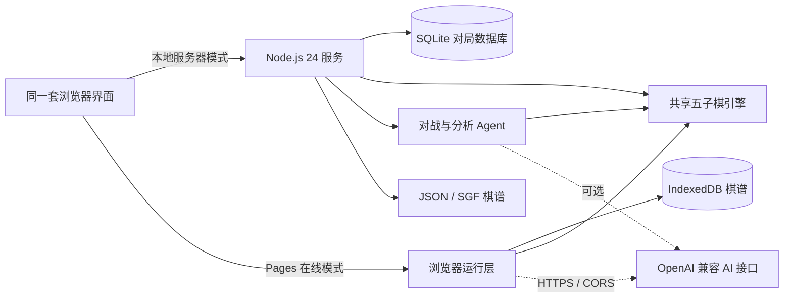

# 架构与接口

前端采用原生 HTML、CSS 和 JavaScript，提供两种运行方式。Node.js 版本使用 HTTP API 与内置 `node:sqlite` 保存对局；GitHub Pages 版本使用 `browser/` 目录中的浏览器接口和 IndexedDB，直接在网页中完成对战，不依赖后端。

`scripts/build-pages.mjs` 把 `public/`、`browser/` 和规范来源 `lib/engine.js` 组合成静态站点。构建时添加运行模式元数据，前端据此选择浏览器接口或 HTTP API。所有资源均能在项目子路径下加载，生成的模块引用带构建内容版本，源码中不维护重复的棋力引擎。

## 数据与规则

棋盘是 `board[y][x]` 的 15 × 15 数组：`0` 为空位，`1` 为黑，`2` 为白。坐标从零开始，合法范围为 `0..14`。黑先白后，横、竖、两条斜线任一方向连续至少五子获胜；采用自由规则，不含三三、四四、长连禁手。

对局对象包含 ID、模式、难度、人类执子、当前行棋方、状态、胜者、创建时间、更新时间和有序落子列表。落子记录包含坐标、颜色、手数和分析信息。两个运行层使用相同的数据形状与共享规则，刷新页面可以恢复已经成功保存的落子。

Pages 在线版把对局保存在当前浏览器的 IndexedDB，按网站来源隔离，不能自动同步到另一台设备。保存使用事务与修订号校验，避免同时打开多个标签页时覆盖较新的棋局。无法使用 IndexedDB 时明确提示临时内存模式；写入失败时拒绝该次保存，不显示虚假的保存成功。API Key 和临时模型配置不写入对局存储。

每个浏览器通过随机匿名会话 Cookie 拥有自己的对局。Cookie 设置 `HttpOnly` 和 `SameSite=Lax`，数据库保存令牌的 SHA-256 散列；读取或修改其他会话的对局返回 404。清除 Cookie 后没有账号恢复途径，数据库中的棋局仍存在，但原会话访问权限丢失。

本地引擎优先处理立即取胜和阻止对手取胜，再对有限候选进行棋形与局势评估。评分为启发式相对指标，不表示统计胜率。难度影响候选或搜索策略；引擎不承诺专业竞赛棋力。

## Agent 与自接入 AI

Agent 围绕实际棋盘执行「读取状态 → 分析威胁与候选 → 可选调用远程模型 → 校验行动 → 落子或给出建议」。工具执行信息供界面展示，帮助解释选择来源。

远程模型通过 OpenAI 兼容 Chat Completions 接口接入，执行最多三轮工具调用。应用不信任模型生成的坐标，落子前由当前运行层校验棋盘边界、空位、回合、终局状态和合法候选。超时、不可解析结果、非法落子或服务失败时回退本地引擎。

Pages 在线版通过浏览器直接调用用户指定的 HTTPS 接口，密钥只在当前页面内存中使用。接口须支持 CORS；没有自动使用外部公共代理。Node.js 版本经本应用后端调用接口，因此不受服务商浏览器跨域策略限制。

默认需要用户在当前页面输入自己的临时 Key。Node.js 版本只有明确设置 `ALLOW_SHARED_AI=true` 时才使用服务器的共享 `AI_API_KEY`，共享凭据固定发送到部署者配置的接口；Pages 版本没有共享服务器密钥。服务端配置状态接口不返回密钥。Node.js 版本默认阻止私有网络 AI 地址；只有自用环境显式启用 `ALLOW_PRIVATE_AI_ENDPOINTS` 才允许连接本地模型。

本地点评记录最佳候选和当前落子的评分差，并给出优秀、良好、不够精确或失误等解释；该分类依赖启发式引擎。语言模型用于补充解释，也可能产生错误，不能替代规则校验。

## HTTP API

请求和正常响应使用 JSON。导出接口返回下载文件。接口路径中的 `:id` 是对局 ID。

下表是 Node.js 版本的 HTTP 接口。浏览器运行层提供对应的本地 `request(path, body)` 操作，复用同一套界面；这些操作不会向 GitHub Pages 请求不存在的 `/api/` 后端。在线版导出直接生成 Blob 下载。

| 方法 | 路径 | 用途 |
| --- | --- | --- |
| GET | `/api/health` | 服务健康检查 |
| GET | `/api/config` | 棋盘规则和 AI 配置状态，不返回 Key |
| GET | `/api/games` | 历史对局列表 |
| POST | `/api/games` | 创建对局，参数 `mode`、`difficulty`、`humanColor` |
| GET | `/api/games/:id` | 读取对局 |
| POST | `/api/games/:id/moves` | 提交人类落子 `{x,y}` |
| POST | `/api/games/:id/agent` | 请求 Agent 落子 |
| POST | `/api/games/:id/undo` | 悔棋 |
| POST | `/api/games/:id/hint` | 获取建议和局面分析 |
| POST | `/api/games/:id/analyze` | 分析当前局面或指定 `moveNumber` 的局面 |
| GET | `/api/games/:id/export?format=json` | 下载 JSON 棋谱 |
| GET | `/api/games/:id/export?format=sgf` | 下载 SGF 棋谱 |

`mode` 为 `ai` 或 `local`；`difficulty` 为 `easy`、`standard`、`hard`；`humanColor` 为 `1` 或 `2`。AI 相关 POST 可携带临时 `ai: {baseUrl,apiKey,model}` 配置。Key 不写入棋谱和数据库。

人类落子和 Agent 落子是两个明确的请求：前端先保存人类落子，再请求 AI 回复。这样刷新或断网后仍可恢复已完成的落子，并且界面可以显示 Agent 思考状态。

## 交付和扩展

GitHub Actions 负责语法检查与测试，GitHub Pages 发布可直接对弈的浏览器版，Docker / Render 可运行带服务器数据库的版本。当前无需购买云端资源即可在线游玩。持久 SQLite 适合单实例部署；在线远程双人匹配、可恢复的注册账号、跨设备同步、团队权限和多实例扩展需要后续加入对应服务与数据库迁移，不应仅通过增加容器副本实现。
